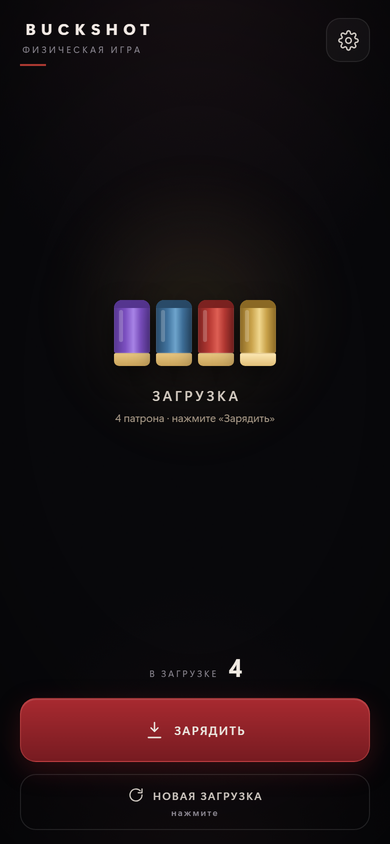
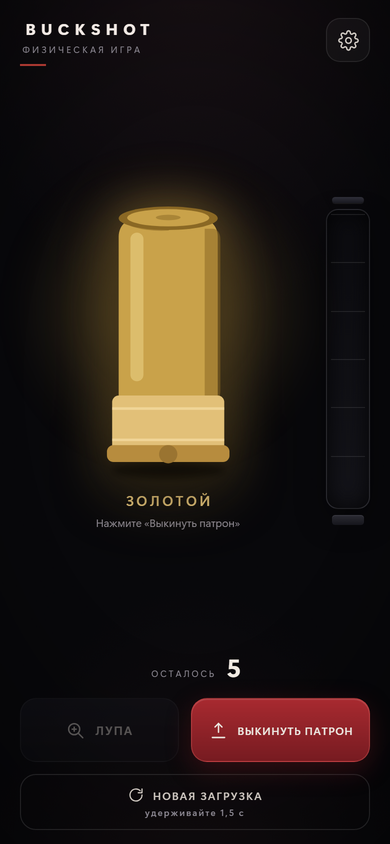

# Buckshot

PWA-помощник для физической игры Buckshot Roulette: генератор загрузки, лупа и история патронов. Работает офлайн, устанавливается на главный экран Android и размещается на GitHub Pages без бэкенда и платных сервисов.



*На скриншоте для наглядности включены особые патроны.*

## Возможности

- Загрузка собирается в два этапа: состав по таблице весов, затем перемешивание.
- Перед партией показывается состав загрузки, сгруппированный по типам: фиолетовые, синие, красные, золотые. Порядок зарядки не раскрывается. «Зарядить» скрывает превью и начинает партию.
- «Лупа» один раз показывает текущий патрон; после выкидывания снова доступна.
- «Выстрелить» показывает тип патрона, после чего кнопка меняется на «Выкинуть патрон». Следующий патрон появляется только после выкидывания.
- История пополняется в момент выкидывания; выстрелянный патрон всё это время виден крупно на экране.
- Золотой патрон заменяет боевой, фиолетовый — холостой. Каждый тип разыгрывается отдельно, максимум по одному на загрузку, общее число патронов не меняется.
- Настройка «Особые патроны при загрузке»: можно показывать золотой и фиолетовый сразу или маскировать их под боевой и холостой. При выстреле и лупе настоящий цвет виден всегда.
- История патронов снизу вверх и шкала загрузки; историю и количество можно отключать независимо.
- Вибрация с настройкой силы (длительности импульса) и отключением.
- Настройки сохраняются в `localStorage`; текущая партия не сохраняется — при запуске всегда новая загрузка.
- PWA: манифест, service worker, офлайн-режим, установка на Android.



## Локальный запуск

Двойной щелчок по `index.html` не сработает: приложению нужен HTTP-сервер (service worker и ES-модули). На Windows проще всего запустить `start.cmd` — откроется браузер с приложением. Нужен установленный Node.js.

Вручную из папки проекта:

```bash
node serve.mjs
```

или

```bash
python -m http.server 8080
```

или

```bash
npx serve .
```

Затем откройте <http://localhost:8080>. Остановить сервер — `Ctrl+C` в окне консоли.

Тесты (Node.js 20+):

```bash
npm test
```

## Публикация на GitHub Pages

1. Создайте репозиторий, например `buckshot`.
2. Загрузите в него **содержимое** этой папки, а не саму папку `buckshot`.
3. В репозитории откройте **Settings → Pages**.
4. В разделе **Build and deployment** выберите **Source: Deploy from a branch**, ветку `main` и папку `/ (root)`, нажмите **Save**.
5. Через минуту приложение будет доступно по адресу `https://<username>.github.io/buckshot/`.

Все пути относительные, поэтому имя репозитория может быть любым. Если репозиторий называется `<username>.github.io`, адрес будет без подпапки.

### Установка на Android

1. Откройте адрес приложения в Chrome.
2. Дождитесь первой полной загрузки (service worker кэширует файлы).
3. Меню Chrome (⋮) → **Установить приложение** или **Добавить на главный экран**.
4. После установки приложение открывается без адресной строки и работает офлайн.

На некоторых устройствах кнопка установки появляется в адресной строке или в меню «Ещё».

## Обновление

После изменения файлов поднимите версию кэша в `sw.js`:

```js
const VERSION = 'buckshot-v2';
```

Затем закоммитьте изменения. GitHub Pages обновит сайт, а service worker подтянет новую версию при следующем открытии. Иногда нужно открыть приложение дважды: GitHub кэширует `sw.js` до 10 минут.

## Настройки

| Настройка | По умолчанию | Когда применяется |
|---|---|---|
| Золотой патрон | выключен, шанс 20% | к следующей загрузке |
| Фиолетовый патрон | выключен, шанс 20% | к следующей загрузке |
| Особые патроны при загрузке | показываются | сразу, на экране загрузки |
| История патронов | включена | сразу |
| Показывать количество | включено | сразу |
| Вибрация | включена, средняя | сразу |

Если количество скрыто, шкала остаётся простым прямоугольником без делений и числа. История при этом продолжает показывать только уже израсходованные патроны.

Маскировка особых патронов действует только на экран загрузки: лупа и выстрел всегда показывают настоящий тип.

Кнопка «Новая загрузка» на экране загрузки и после пустой загрузки срабатывает по нажатию, а в середине партии — по удержанию 1,5 секунды, чтобы случайно не сбросить загрузку.

## Структура

```
index.html            разметка экрана и настроек
styles.css            оформление
app.js                состояние партии и интерфейс
generator.js          состав, перемешивание, особые патроны
settings.js           значения по умолчанию, проверка, localStorage
manifest.webmanifest  манифест PWA
sw.js                 service worker
serve.mjs             локальный статический сервер
start.cmd             запуск сервера в один клик (Windows)
icons/                иконки приложения
tests/                тесты генератора и настроек
preview/              скриншоты для README
```

## Ограничения

- APK на этом этапе не создаётся. При необходимости PWA можно обернуть в Trusted Web Activity через Bubblewrap.
- Нет сервера, аккаунтов и синхронизации: всё считается на устройстве.
- Нет звука и push-уведомлений — только вибрация.
- Для бесплатного GitHub Pages репозиторий должен быть публичным.

Buckshot — неофициальный помощник для настольной игры, не связанный с разработчиками оригинальной видеоигры.
